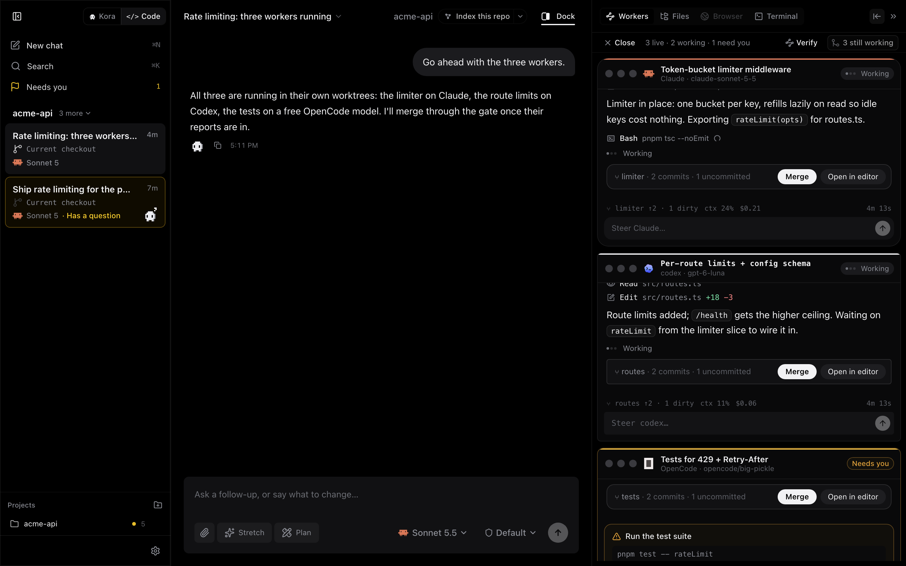
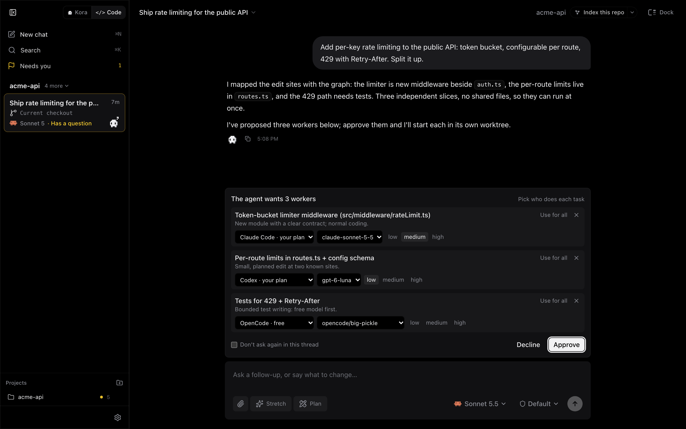
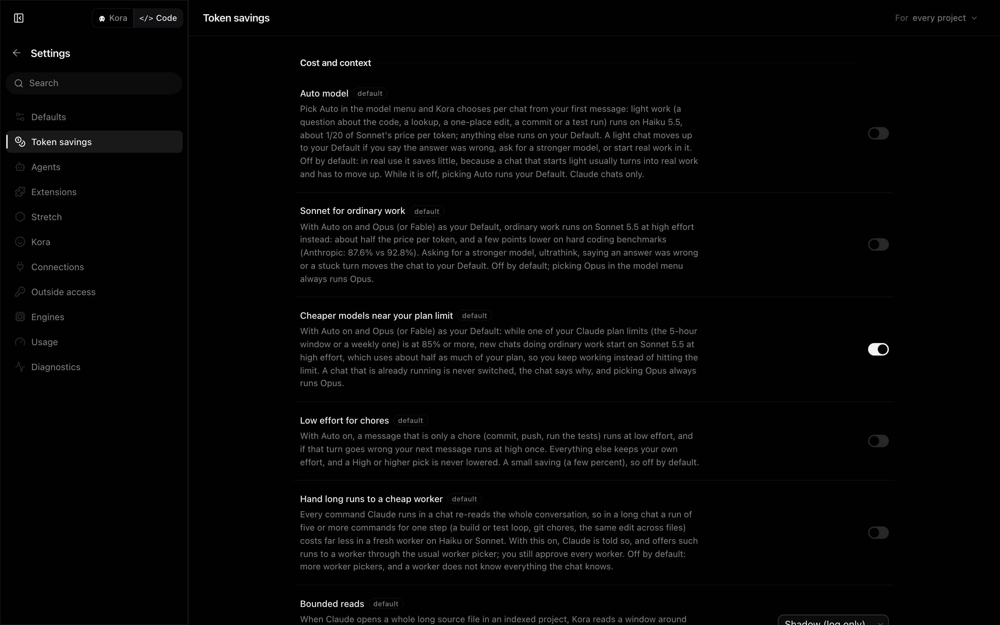
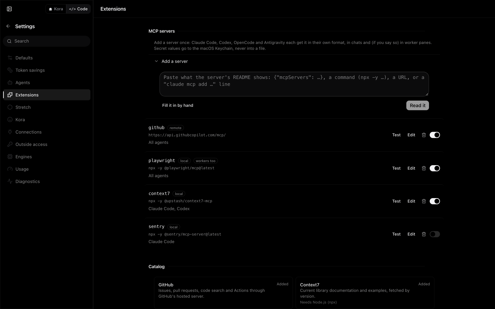

<p align="center">
  
</p>

<h1 align="center">Kora</h1>

<p align="center">
  <b>One lead agent. A fleet of workers you can watch. A smaller bill.</b><br>
  A Mac app that runs Claude Code, Codex, OpenCode and Antigravity as an orchestrated team,<br>
  with a local code graph that keeps every agent's context small.
</p>

<p align="center">
  <a href="https://github.com/agilkatakam/kora/releases/latest"><b>Download for Mac</b></a> ·
  <a href="docs/ORCHESTRATOR.md">How the orchestrator works</a> ·
  <a href="docs/SAVINGS.md">Where the savings come from</a> ·
  <a href="docs/EXTENSIONS.md">MCP servers and skills</a> ·
  <a href="CONTRIBUTING.md">Contributing</a>
</p>

<p align="center">
  <a href="LICENSE"></a>
  
  <a href="https://github.com/Koragraph/Kora/actions/workflows/ci.yml"></a>
</p>

<p align="center">
  
</p>

## Why Kora

Coding agents are good at doing one thing at a time and expensive at doing everything at once. A single long session
re-reads its whole context on every call, so the bill grows with the conversation, not with the work. Kora splits the
work instead:

- **A lead plans and delegates.** It keeps the conversation with you and hands bounded slices to workers.
- **Workers run in parallel, in the open.** Each one is a real agent CLI in its own git worktree, in a pane you can
  read, steer or stop. You approve every worker the lead proposes, and the model and effort it runs on.
- **Merges are checked, not hoped for.** Before a worker's branch lands, a graph-verified gate looks for changes that
  git would merge cleanly but that break each other (a renamed function one worker still calls, a changed signature).
- **Every agent gets a map of your code.** A local code graph answers "where is this, who calls it" in one step, and
  Kora puts the relevant declarations in front of the agent before it starts searching.

Everything runs on your Mac. There is no Kora account, no server, no telemetry.

## The orchestrator

<p align="center">
  
</p>

You talk to one thread. When the work splits, the lead proposes workers (one row per task: which agent, which model,
how much effort, and why) and you approve or change them. Then:

1. Each worker starts in its own worktree on its own branch, with a brief that names the files to touch and the
   command that proves the slice is done.
2. Workers run as live panes beside the chat. You can type into any of them, and the lead sees what you said.
3. The lead waits for reports, reads what it needs, and merges branches through the graph-verified gate.
4. A worker you stop stays stopped: the lead is told not to respawn it.

Leads can be Claude Code, Codex or OpenCode. Workers can be any of the four agents. **Stretch** (the button in the
composer) makes the lead hand work to free models first, through OpenCode, and to cheap paid tiers only when no free
worker can do it. Details: [docs/ORCHESTRATOR.md](docs/ORCHESTRATOR.md).

## Cost savings

<p align="center">
  
</p>

The money in agent work goes to re-reading context. Kora attacks that in four places:

| Lever                        | What it does                                                                                                                                                                                                                     |
| ---------------------------- | -------------------------------------------------------------------------------------------------------------------------------------------------------------------------------------------------------------------------------- |
| **Where the work runs**      | A long run of commands costs far less in a fresh, cheap worker than in a lead that re-reads 150k tokens on every call. The worker picker suggests the cheapest model that can do each slice. Free OpenCode workers cost nothing. |
| **What the agent reads**     | Code-shaped prompts get the matching declarations injected up front; a cold identifier search is pointed at the graph once; a repeated whole-file read is nudged toward a line range.                                            |
| **How big the context gets** | Earlier compaction for Kora-started sessions, trimmed tool output (long command output becomes head, errors, tail), lean worker panes without unused skill listings or tools.                                                    |
| **Your plan's limits**       | Usage of your Claude, Codex and Antigravity plans in one place. Near a limit, new threads can start on a cheaper model instead of stopping you.                                                                                  |

The in-app meter shows what Kora saved, priced at each model's own list price. It books wins only and says so: it is
an estimate, not a bill. Every lever is a switch in Settings › Token savings. What we measured, and what we measured
and decided not to build: [docs/SAVINGS.md](docs/SAVINGS.md).

## Works with your agents

|                                                               | Claude Code | Codex | OpenCode | Antigravity |
| ------------------------------------------------------------- | :---------: | :---: | :------: | :---------: |
| Chat in Kora                                                  |      ✓      |   ✓   |    ✓     |      ✓      |
| Lead an orchestrated fleet                                    |      ✓      |   ✓   |    ✓     |      —      |
| Run as a worker                                               |      ✓      |   ✓   |    ✓     |      ✓      |
| Code graph declarations injected                              |      ✓      |   ✓   |    ✓     |      ✓      |
| Your MCP servers from Kora ([Extensions](docs/EXTENSIONS.md)) |      ✓      |   ✓   |    ✓     |      ✓      |
| Your skills from Kora                                         |      ✓      |   ✓   |    ✓     |      ✓      |
| Plan usage meter                                              |      ✓      |   ✓   |    —     |      ✓      |

Sign in with each agent's own login; Kora uses your existing subscriptions and never sees your credentials. One
working agent is enough. Full details per agent: [docs/HARNESSES.md](docs/HARNESSES.md).

## MCP servers and skills, added once

<p align="center">
  
</p>

Paste whatever an MCP server's README shows (a `{"mcpServers": …}` block, a Codex TOML section, an `npx …` command, a
URL or a `claude mcp add …` line) and every agent gets it, in chats and, if you say so, in worker panes. Kora can also
import what your agents already have configured, start from a short checked catalog (GitHub, Playwright, Context7,
Notion, Sentry, …) and test a server before you save it. Secret values go to the macOS Keychain, never into a file.

```sh
kora ext add memory -- npx -y @modelcontextprotocol/server-memory
kora ext import --yes          # what Claude Code / Codex / OpenCode / Antigravity already have
kora ext skill add https://github.com/owner/skills
```

A repository can share servers with its team in `.kora/extensions.json`; nothing in it runs until each person allows
it. More: [docs/EXTENSIONS.md](docs/EXTENSIONS.md).

## Install

**Apple Silicon Mac, macOS 13.5 or later.**

1. Download **Kora-arm64.dmg** from the [latest release](https://github.com/agilkatakam/kora/releases/latest) and drag
   Kora to Applications. It is signed and notarized and updates itself.
2. Open Kora and sign in to the agents you use. Claude has a one-click login on the first screen; Codex
   (`codex login`), OpenCode (`opencode auth login`) and Antigravity (`agy`) use their own, listed on the same screen.
3. Open a project folder and ask your first question. Index the project from the chip next to its name to turn on the
   code graph.

Kora keeps a small background service running after you close the window (the `kora` command, git hooks and workers
use it). Stop it with `kora server stop` or in Settings › General.

## Build from source

```sh
git clone https://github.com/Koragraph/Kora.git && cd Kora
pnpm install          # Node 24, pnpm 11, Xcode command line tools
pnpm build            # runtime, UI server bundle, web client, desktop shell
pnpm start            # run the app from this checkout
```

`pnpm dev` runs it with the web client hot-reloading; `pnpm app:package` builds a self-contained `dist/Kora.app`.
How the pieces fit: [docs/ARCHITECTURE.md](docs/ARCHITECTURE.md). Working on Kora: [AGENTS.md](AGENTS.md).

## Privacy

No account, no analytics, no telemetry. Your code, chats and code graph stay on your Mac
(`~/.kora`, `~/.koragraph`). Your agents talk to their own providers exactly as they would without Kora. Swarm workers
on free models send the task they are given to that free provider; the first-run setup says so before you turn it on.

## Community

- Questions and ideas: [Discussions](https://github.com/Koragraph/Kora/discussions)
- Bugs: [Issues](https://github.com/Koragraph/Kora/issues) (Settings › Diagnostics › Export diagnostics makes a
  redacted bundle to attach)
- Security: see [SECURITY.md](SECURITY.md); please do not open a public issue
- Contributing: [CONTRIBUTING.md](CONTRIBUTING.md)

## License

[MIT](LICENSE). "Kora" and the Kora mark are not licensed for use by forks or derived products; see
[TRADEMARKS.md](TRADEMARKS.md).
